  

  <h1>Basina — Smart Healthcare, Everywhere</h1>

  

    <strong>Telemedicine, online doctor consultations, AI-assisted lab interpretation, and electronic health records.</strong> 
    Built in Iran for patients across the country — expanding to the Persian Gulf, West Asia, and English- and Arabic-speaking communities worldwide.
  

  

    
    
    
    
  

---

**Basina** (باسینا) is an Iranian digital health platform that combines licensed physicians with AI-assisted tools to make healthcare more accessible. Patients can book in-person appointments, consult doctors online, understand their lab results, check symptoms, and keep a consent-based electronic health record — from any device, wherever they are.

The platform serves users across Iran through a network of **900+ doctors**, **260+ online consultation doctors**, **107 specialties**, and **56 cities**. Our next chapter is international: bringing Persian-, Arabic-, and English-language telehealth to the Persian Gulf, West Asia, and beyond.

[English](#overview) · [فارسی](#فارسی) · [العربية](#العربية)

---

## Table of contents

- [Overview](#overview)
- [Services](#services)
- [How it works](#how-it-works)
- [Coverage and expansion](#coverage-and-expansion)
- [For doctors and clinics](#for-doctors-and-clinics)
- [AI with human oversight](#ai-with-human-oversight)
- [Privacy and trust](#privacy-and-trust)
- [Quick links](#quick-links)
- [Repository scope](#repository-scope)
- [Contributing](#contributing)
- [License](#license)
- [فارسی](#فارسی)
- [العربية](#العربية)

---

## Overview

Healthcare is unevenly distributed. Specialist care, timely interpretation of lab results, and a reliable medical history are often concentrated in major cities — while many patients live far from the right doctor or wait too long for answers.

Basina closes that gap with a single digital front door:

- **Access** — find a doctor by specialty, city, or availability, and choose an in-person or online visit.
- **Understanding** — turn complex lab reports and symptoms into clear, patient-friendly explanations with AI assistance.
- **Continuity** — keep results, consultations, and health trends in an electronic record that belongs to the patient and is created with their consent.
- **Human oversight** — AI supports the journey; licensed doctors remain responsible for medical review, advice, and treatment decisions.

Basina is designed for patients, families, doctors, and clinics. The Persian experience is live today; English and Arabic journeys are part of the international roadmap.

---

## Services

*Six connected services, one consent-based record.*

### For patients

| Service | What it does | Start here |
| --- | --- | --- |
| **Online appointment booking** | Reserve an in-person visit with 900+ doctors across 56 cities, filtered by specialty and location. | [Book an appointment](https://basina.app/doctors/product/Appointment) |
| **Online doctor consultation** | Talk to a licensed specialist by text or video — 260+ online doctors across 107 specialties. | [Consult a doctor](https://basina.app/doctors/product/Telemedicine) |
| **AI lab test interpretation** | Upload a photo or PDF of lab results and get a clear explanation of the values, what they may mean, and what to discuss with a doctor. Supports blood, urine, thyroid, pregnancy, screening, genetic, ultrasound, mammography, and full checkup reports. | [Interpret a lab test](https://basina.app/services/test-interpretation) |
| **AI symptom triage** | Enter your symptoms and receive a structured preliminary assessment with guidance on the appropriate next step. | [Check symptoms](https://basina.app/services/triage) |
| **Electronic health record** | Store results with consent, follow health trends over time, manage family profiles, and receive reminders for follow-ups and checkups. | [About Basina](https://basina.app/about-us) |
| **Symptoms library** | Read patient-friendly guides on conditions, warning signs, and when to seek care. | [Browse symptoms](https://basina.app/services/symptoms) |
| **BMI calculator** | Calculate and track body mass index as part of a preventive-health routine. | [Calculate BMI](https://basina.app/services/bmi) |
| **Health community** | Ask questions and learn from shared experiences in a moderated community space. | [Visit the community](https://basina.app/community) |
| **Medical facilities directory** | Find clinics, laboratories, and treatment centers in supported cities. | [Find facilities](https://basina.app/facilities) |

### For doctors and clinics

Basina gives doctors a digital practice layer: a public profile, online appointment management, text and video consultations, access to patient records, and a direct channel to patients beyond their local city.

- **Doctor panel:** [panel.basina.app](https://panel.basina.app/)
- **Join the network:** [Contact Basina](https://basina.app/contact-us)

---

## How it works

1. **Choose a service** — appointment, online consultation, lab interpretation, symptom triage, or a health record review.
2. **Share what matters** — select a doctor, upload a lab report, or describe symptoms in a secure patient journey.
3. **Get AI-assisted clarity** — where enabled, AI organizes the information and highlights values or patterns that deserve attention.
4. **Review with a doctor** — licensed physicians provide context, answer questions, and recommend the next step when needed.
5. **Keep the record** — with consent, results and consultations are saved to the electronic health record for continuity and follow-up.

---

## Coverage and expansion

### Today

- **Online services:** available to users across Iran, regardless of province.
- **In-person appointment network:** active doctor coverage in **Hormozgan**, **Fars (Shiraz)**, **Kerman**, **Isfahan**, **Bushehr**, and **Khuzestan**, with appointments in **56 cities**.
- **Specialties:** 107 specialties, from cardiology and dermatology to fertility, pediatrics, mental health, nutrition, and dentistry.

### Where we are going

Basina is preparing multilingual, region-ready telehealth for:

- the **Persian Gulf** and **West Asia**;
- **Arabic-speaking** patients and clinicians;
- **English-speaking** patients and international families;
- cross-border second opinions and specialist access.

The goal is not to replace local care, but to connect patients to the right expertise — in their language, with a clear medical record, and with licensed doctors in the loop.

> International availability, languages, and payment options are being rolled out progressively. Check [basina.app](https://basina.app) for the current service area.

---

## For doctors and clinics

Basina is also infrastructure for clinicians who want to serve patients beyond their waiting room.

- Publish a professional profile and specialty listing.
- Manage in-person appointments and online consultations.
- Offer text or video visits with a documented history.
- Use the electronic health record to follow patients over time.
- Reach Persian-speaking patients across Iran and, as the platform expands, regional and international patients.

Doctors and clinics interested in joining can register through the [Basina doctor panel](https://panel.basina.app/) or contact the team at [info@basina.app](mailto:info@basina.app).

---

## AI with human oversight

Basina's AI features are designed as a **support layer**, not a replacement for clinical judgment.

- **AI is assistive.** Lab interpretations and symptom assessments are informational and may be incomplete or inaccurate.
- **Doctors decide.** Licensed physicians remain responsible for diagnosis, treatment, and medical advice.
- **Context matters.** A lab value or symptom means little without history, examination, and clinical context.
- **Urgency is different from diagnosis.** Triage helps patients choose the right level of care; it does not confirm or rule out a condition.

> **Medical disclaimer:** Basina does not provide emergency care. If you have chest pain, difficulty breathing, severe bleeding, stroke symptoms, or another emergency, contact your local emergency services immediately. Do not delay care because of an AI-generated result.

---

## Privacy and trust

Health data is among the most sensitive information a person can share. Basina's patient record is built around consent and controlled access.

- An electronic health record is created and stored **with the user's consent**.
- Patients choose what to share and with whom.
- Personal health information should never be posted in GitHub issues, pull requests, or public discussions.
- Only upload medical documents that belong to you or that you have explicit permission to share.
- For questions about data handling, account access, or deletion, contact Basina directly through the [contact page](https://basina.app/contact-us).

This repository contains **no patient data** and is not connected to production systems.

---

## Quick links

| | |
| --- | --- |
| **Website** | [basina.app](https://basina.app) |
| **Doctors** | [Browse 900+ doctors](https://basina.app/doctors) |
| **In-person appointment** | [Book a visit](https://basina.app/doctors/product/Appointment) |
| **Online consultation** | [Talk to a doctor](https://basina.app/doctors/product/Telemedicine) |
| **AI lab interpretation** | [Interpret lab results](https://basina.app/services/test-interpretation) |
| **AI symptom triage** | [Check symptoms](https://basina.app/services/triage) |
| **Symptoms library** | [Browse conditions](https://basina.app/services/symptoms) |
| **BMI calculator** | [Open BMI tool](https://basina.app/services/bmi) |
| **Health community** | [Join the discussion](https://basina.app/community) |
| **Medical facilities** | [Find a center](https://basina.app/facilities) |
| **Mobile app** | [Download Basina](https://basina.app/downloads) |
| **Blog** | [Health articles](https://basina.app/blog/) |
| **Doctor panel** | [panel.basina.app](https://panel.basina.app/) |
| **About Basina** | [Our story](https://basina.app/about-us) |
| **Contact** | [info@basina.app](mailto:info@basina.app) |

---

## Repository scope

This repository hosts the **public project overview** and a minimal landing page for Basina. It is a public information entry point — not the production platform.

The clinical application, doctor panel, patient records, AI pipelines, and payment systems run on Basina's secured infrastructure and are not published here. No patient data, credentials, or production configuration belong in this repository.

The `assets/` directory contains the original SVG graphics used in this README. They are hand-authored, include lightweight CSS animation, respect `prefers-reduced-motion`, and can be edited as plain text. Brand assets remain the property of Basina.

If you are looking for the live product, start at [basina.app](https://basina.app). If you are a developer, researcher, or healthcare partner interested in collaboration, see [Contributing](#contributing).

---

## Contributing

This repository is primarily documentation. Contributions that improve accuracy, accessibility, translations, or the public landing page are welcome.

- Open an issue for corrections, broken links, or translation improvements.
- Keep pull requests focused and explain the change.
- **Do not include personal health information, medical records, or patient identifiers** in any issue or pull request.
- For medical questions, account support, or appointment issues, contact Basina directly — GitHub is not a support channel.
- If you believe you have found a security issue, please email [info@basina.app](mailto:info@basina.app) privately instead of opening a public issue.

---

## License

The contents of this repository are available under the [MIT License](LICENSE).

The Basina name, logo, brand assets, and product identity are the property of Basina and are not granted for reuse under the MIT License. Medical content on the platform is provided for general information and does not replace professional medical advice.

---

## فارسی

  

**باسینا** یک پلتفرم سلامت دیجیتال ایرانی است که پزشکان متخصص را با ابزارهای هوش مصنوعی ترکیب می‌کند تا دسترسی به خدمات سلامت ساده‌تر، سریع‌تر و عادلانه‌تر شود. کاربران می‌توانند نوبت حضوری بگیرند، به‌صورت آنلاین با پزشک مشاوره کنند، نتیجه آزمایش را بفهمند، علائم خود را بررسی کنند و پرونده الکترونیک سلامت داشته باشند.

باسینا امروز در سراسر ایران در دسترس است و بیش از **۹۰۰ پزشک**، بیش از **۲۶۰ پزشک مشاوره آنلاین**، **۱۰۷ تخصص** و **۵۶ شهر** را پوشش می‌دهد. مرحله بعدی توسعه، ارائه خدمات چندزبانه به کاربران فارسی‌زبان، عرب‌زبان و انگلیسی‌زبان در منطقه خلیج فارس، غرب آسیا و سایر نقاط جهان است.

### خدمات باسینا

- **نوبت‌دهی اینترنتی:** رزرو نوبت حضوری از میان بیش از ۹۰۰ پزشک در ۵۶ شهر، با فیلتر تخصص و شهر.
- **مشاوره آنلاین پزشک:** گفتگوی متنی و تصویری با بیش از ۲۶۰ پزشک در ۱۰۷ تخصص.
- **تفسیر آزمایش با هوش مصنوعی:** آپلود عکس یا PDF جواب آزمایش و دریافت توضیح ساده و قابل فهم؛ شامل آزمایش خون، ادرار، تیروئید، بارداری، غربالگری، ژنتیک، سونوگرافی، ماموگرافی و چکاپ کامل.
- **تریاژ و بررسی علائم با هوش مصنوعی:** ورود علائم و دریافت ارزیابی اولیه و راهنمایی برای اقدام بعدی.
- **پرونده الکترونیک سلامت:** ذخیره نتایج با رضایت کاربر، نمودار روند سلامت، پروفایل خانواده و یادآوری چکاپ‌ها.
- **کتابخانه علائم و بیماری‌ها:** راهنمای قابل فهم برای شناخت علائم و زمان مراجعه به پزشک.
- **محاسبه BMI:** محاسبه و پیگیری شاخص توده بدنی.
- **تالار گفتگو و مراکز درمانی:** جامعه سلامت و فهرست مراکز درمانی در شهرهای تحت پوشش.

### پوشش جغرافیایی

- **خدمات آنلاین:** برای کاربران سراسر ایران.
- **شبکه نوبت‌دهی حضوری:** هرمزگان، فارس (شیراز)، کرمان، اصفهان، بوشهر و خوزستان؛ با نوبت‌دهی در ۵۶ شهر.
- **تخصص‌ها:** ۱۰۷ تخصص، از قلب و پوست گرفته تا نازایی، کودکان، سلامت روان، تغذیه و دندانپزشکی.

### چشم‌انداز بین‌المللی

باسینا در حال آماده‌سازی تجربه‌ای چندزبانه و منطقه‌ای برای ارائه خدمات به:

- کشورهای **خلیج فارس** و **غرب آسیا**؛
- کاربران **عرب‌زبان**؛
- کاربران **انگلیسی‌زبان** و خانواده‌های بین‌المللی؛
- دریافت نظر تخصصی دوم و دسترسی به متخصصان فراتر از مرزها.

هدف، جایگزینی درمان محلی نیست؛ اتصال بیمار به تخصص مناسب، به زبان خودش و با پرونده‌ای روشن و حضور پزشک متخصص است.

> دسترسی بین‌المللی، زبان‌ها و روش‌های پرداخت به‌تدریج منتشر می‌شوند. محدوده فعلی خدمات را در [basina.app](https://basina.app) ببینید.

### برای پزشکان و مراکز درمانی

پزشکان و کلینیک‌ها می‌توانند از طریق [پنل پزشکان باسینا](https://panel.basina.app/) ثبت‌نام کنند، پروفایل تخصصی بسازند، نوبت‌های حضوری و آنلاین را مدیریت کنند و به پرونده الکترونیک بیمار دسترسی داشته باشند. برای همکاری با تیم باسینا: [info@basina.app](mailto:info@basina.app).

### ایمنی هوش مصنوعی و هشدار پزشکی

ابزارهای هوش مصنوعی باسینا فقط برای **پشتیبانی اطلاعاتی** طراحی شده‌اند و جای تشخیص و درمان پزشک را نمی‌گیرند. خروجی هوش مصنوعی ممکن است ناقص یا نادرست باشد و باید توسط پزشک متخصص بررسی شود.

> **هشدار:** باسینا خدمات اورژانسی ارائه نمی‌دهد. در صورت درد قفسه سینه، تنگی نفس، خونریزی شدید، علائم سکته یا هر وضعیت اورژانسی، فوراً با اورژانس محلی تماس بگیرید و به‌خاطر یک نتیجه هوش مصنوعی مراجعه به پزشک را به تأخیر نیندازید.

### حریم خصوصی

پرونده الکترونیک سلامت فقط **با رضایت کاربر** ایجاد و ذخیره می‌شود. اطلاعات سلامت شخصی را هرگز در Issue، Pull Request یا بحث عمومی گیت‌هاب قرار ندهید. این مخزن هیچ داده بیمارستانی یا اطلاعات بیمار ندارد و به سیستم‌های عملیاتی باسینا متصل نیست.

### لینک‌های سریع

- [وب‌سایت باسینا](https://basina.app)
- [پزشکان](https://basina.app/doctors)
- [نوبت اینترنتی](https://basina.app/doctors/product/Appointment)
- [مشاوره آنلاین](https://basina.app/doctors/product/Telemedicine)
- [تفسیر آزمایش](https://basina.app/services/test-interpretation)
- [تشخیص بیماری و علائم](https://basina.app/services/triage)
- [کتابخانه علائم](https://basina.app/services/symptoms)
- [دانلود اپلیکیشن](https://basina.app/downloads)
- [پنل پزشکان](https://panel.basina.app/)
- [درباره ما](https://basina.app/about-us)
- [تماس با ما](https://basina.app/contact-us)

---

## العربية

  

**باسينا** منصة رعاية صحية رقمية إيرانية تجمع بين الأطباء المرخّصين وأدوات الذكاء الاصطناعي لتسهيل الوصول إلى الرعاية الصحية. يستطيع المستخدمون حجز موعد حضوري، أو استشارة طبيب عن بُعد، أو فهم نتائج التحاليل، أو تقييم الأعراض، أو الاحتفاظ بملف صحي إلكتروني.

تخدم باسينا اليوم المستخدمين في جميع أنحاء إيران من خلال أكثر من **900 طبيب**، وأكثر من **260 طبيباً للاستشارات عن بُعد**، و**107 تخصصات**، و**56 مدينة**. وتستعد المنصة لتقديم تجربة متعددة اللغات في منطقة الخليج وغرب آسيا والمجتمعات الناطقة بالعربية والإنجليزية.

### الخدمات

- **حجز المواعيد الحضورية** مع أكثر من 900 طبيب في 56 مدينة.
- **الاستشارات الطبية عن بُعد** نصياً وبالفيديو مع أكثر من 260 طبيباً في 107 تخصصات.
- **تفسير نتائج التحاليل بالذكاء الاصطناعي**: رفع صورة أو ملف PDF لنتيجة التحليل والحصول على شرح مبسّط؛ يشمل تحاليل الدم والبول والغدة الدرقية والحمل والفحوصات الشاملة وغيرها.
- **تقييم الأعراض والفرز الصحي** بالذكاء الاصطناعي للمساعدة في تحديد الخطوة التالية.
- **الملف الصحي الإلكتروني**: يُنشأ بموافقة المستخدم، ويتيح متابعة المؤشرات الصحية، وإدارة ملفات أفراد الأسرة، والتذكير بالفحوصات الدورية.
- **مكتبة الأعراض**، و**حاسبة كتلة الجسم**، و**المجتمع الصحي**، و**دليل المراكز الطبية**.

### التغطية والتوسع

تُقدَّم الخدمات الرقمية للمستخدمين في جميع أنحاء إيران، مع شبكة مواعيد حضورية في هرمزكان وفارس (شيراز) وكرمان وأصفهان وبوشهر وخوزستان. نعمل على توسيع الخدمات إلى دول الخليج وغرب آسيا، وتقديم تجارب باللغة العربية والإنجليزية، مع إبقاء الطبيب المرخّص في صميم عملية الرعاية.

### تنبيه طبي

أدوات الذكاء الاصطناعي في باسينا هي أدوات مساعدة للمعلومات فقط، ولا تُعدّ تشخيصاً طبياً ولا بديلاً عن استشارة طبيب مؤهل. قد تكون النتائج غير مكتملة أو غير دقيقة. في حالات الطوارئ، تواصل فوراً مع خدمات الطوارئ المحلية.

### روابط

- [الموقع الرسمي](https://basina.app)
- [الأطباء](https://basina.app/doctors)
- [حجز موعد حضوري](https://basina.app/doctors/product/Appointment)
- [استشارة عن بُعد](https://basina.app/doctors/product/Telemedicine)
- [تفسير التحاليل](https://basina.app/services/test-interpretation)
- [تقييم الأعراض](https://basina.app/services/triage)
- [لوحة الأطباء](https://panel.basina.app/)
- [اتصل بنا](https://basina.app/contact-us)

---

  Basina — bringing smart, human-centered healthcare closer to everyone.

